# Component Selection: Force Sensing Board

**Zice Sun** · Team 103 (Duotao Gao, Gabriel Toneser Facchin, Zice Sun) · Project: **GripRx**, a prescription-based automatic-resistance grip trainer

## Overview

This page compares at least three candidate solutions for every major component of my subsystem, the **force sensing board**, and explains which one I chose and why. The components follow the blocks of my [individual block diagram](../01-Block-Diagram/Block-Diagram.md): the load cell, the instrumentation amplifier, the op amp originally planned for an active low-pass filter (removed after instructor review; see Section 3), the 5 V voltage regulator and the 9 V external power source. The microcontroller (PIC18F57Q43 Curiosity Nano) is not compared because it was selected for the class.

All five components belong to my individual subsystem and are labeled in bold as **[Individual subsystem: force sensing board]**. The board has no actuator or other electro-mechanical part of its own; the motor and lead screw are on Gabriel's motor board.

The selections were judged against these project specifications and course constraints:

- Measure grip force from 0 to 40 kgf with 0.1 kgf resolution on the PIC's 12-bit ADC (0 to 5 V).
- Run every part from one regulated +5 V rail, fed by a 9 V wall adapter through a through-hole linear regulator.
- Use bare components only (no breakout or daughter boards) in packages the Peralta mill can make (pin pitch ≥ 0.8 mm), so DIP, SOIC, TO-92 and TO-220 are acceptable but MSOP and QFN are not.
- Include an amplifier stage in the sensor signal chain. The instructor approved the INA125P instrumentation amplifier as that stage and advised against extra op-amp buffers and filters.
- Stay within the &#36;60 individual budget; parts handed out in class do not count against it.

Prices are for quantity 1, checked on 2026-10-16 at the linked vendor unless noted.

## Major Component Selections

### 1. Force Sensor (Load Cell)

*Table 1: Load cell selection*

**Load cell — [Individual subsystem: force sensing board]**

| **Solution** | **Pros** | **Cons** |
| --- | --- | --- |
| 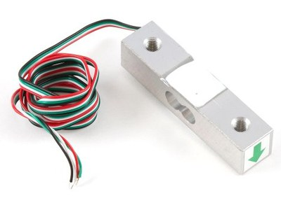{ width="170" } **Option 1.** Phidgets 3135_0 (CZL635-50) 50 kg straight-bar load cell &#36;7.00/each [Phidgets 3135_0 product page](https://www.phidgets.com/?prodid=226) | \* Full 4-wire Wheatstone bridge connects straight to the instrumentation amplifier inputs \* 50 kg capacity covers the 40 kgf maximum grip with 25 % headroom \* Rated output 1 mV/V and a published spec sheet (repeatability, creep, zero balance, 5 V maximum excitation) \* Aluminum bar with M5 threaded holes is easy to mount inside the grip handle \* Inexpensive, with 239 in stock | \* Small output: only 5 mV at full scale with 5 V excitation, so it needs a gain of about 750 \* Sold by Phidgets, not Digi-Key, so it adds a second order and shipping charge \* Zero balance and temperature drift must be removed by taring in firmware |
| 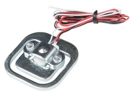{ width="150" } **Option 2.** SparkFun SEN-10245 50 kg load sensor (bathroom-scale corner cell) &#36;6.25/each (Digi-Key, 2026-10-04) [SparkFun SEN-10245 at Digi-Key](https://www.digikey.com/en/products/detail/sparkfun-electronics/SEN-10245/5843757) | \* Lowest unit price of the three options \* Available from Digi-Key, so it can share one order with the rest of the board \* Same 1 mV/V class of output as Option 1 | \* Half bridge (3 wires): needs a second cell or two precision completion resistors to form a full bridge \* Completion resistors add temperature drift that a full bridge cancels \* Flat bathroom-scale shape is designed to sit under a platform and is hard to fit into a hand grip |
| 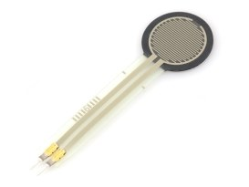{ width="150" } **Option 3.** Interlink FSR 402 force sensitive resistor (SparkFun SEN-09375) &#36;10.95/each (Mouser) [SparkFun SEN-09375 at Mouser](https://www.mouser.com/en/ProductDetail/SparkFun/SEN-09375?qs=WyAARYrbSnZXUsoG9B01Lw%3D%3D) | \* Very thin and light, can be glued onto the grip surface \* Large resistance change: a simple voltage divider and op amp buffer can read it without an instrumentation amplifier \* Responds to light touches, useful for detecting that the user is holding the grip | \* Saturates at a few kilograms, far below the 40 kgf grip range \* Strongly nonlinear, with drift and part-to-part variation of several percent, so it cannot meet the 0.1 kgf resolution goal \* Most expensive of the three for the worst measurement accuracy |

**Choice:** Option 1: Phidgets 3135_0 50 kg straight-bar load cell.

**Rationale:** GripRx sets the motor resistance from the measured grip force, so the force reading must be accurate and repeatable across the whole 0–40 kgf range. Only the two strain-gauge cells can measure that range; the force sensitive resistor saturates at a few kilograms and is too nonlinear for a therapy prescription. Between the two load cells, the Phidgets cell is a complete full bridge, which cancels temperature effects and wires directly to the INA125P with no completion resistors, and its straight-bar shape bolts into the handle. At 5 V excitation it gives 0.1 mV per kgf, so 40 kgf produces 4 mV; with the INA125P gain of 604 this becomes about 2.4 V above the 1.24 V reference (3.7 V at the ADC), and 0.1 kgf is about 5 ADC counts, which meets the resolution goal. The separate Phidgets order is the main drawback; if the shipping pushes me over budget I will buy the cell out of pocket, which the course allows.

### 2. Instrumentation Amplifier

*Table 2: Instrumentation amplifier selection*

**Instrumentation amplifier — [Individual subsystem: force sensing board]**

| **Solution** | **Pros** | **Cons** |
| --- | --- | --- |
| 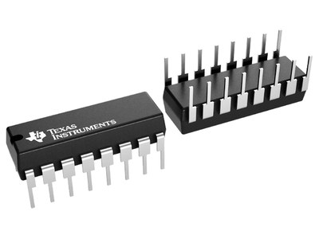{ width="170" } **Option 1.** Texas Instruments INA125P instrumentation amplifier (DIP-16) &#36;12.78/each (Mouser) [TI INA125P at Mouser](https://www.mouser.com/en/ProductDetail/Texas-Instruments/INA125P?qs=VBduBm9rCJSDMcs2CyEvAw%3D%3D) | \* Designed for bridge sensors: high CMRR (100 dB minimum at G = 100 to 500) rejects the 2.5 V common-mode level of the bridge \* Gain set by one resistor, G = 4 + 60 kΩ/RG, from 4 to 10,000 \* Low offset (250 µV maximum) and low quiescent current (525 µA maximum) \* Runs from a single 2.7 V to 36 V supply, so it works on the 5 V rail \* DIP package plugs straight into a breadboard for prototyping | \* Most expensive of the three options \* On a single 5 V supply the output only swings from about 1 V to 3.3 V (worst case), so the reference pin must be offset (solved with its internal 1.24 V reference) \* Not an op amp, so it needs instructor approval |
| { width="170" } **Option 2.** Microchip MCP6N11-100E/SN instrumentation amplifier (SOIC-8) &#36;1.77/each (Mouser) [Microchip MCP6N11-100E/SN at Mouser](https://www.mouser.com/en/ProductDetail/Microchip-Technology/MCP6N11-100E-SN?qs=YyMeZBPsWN6ib594iL%252B2ug%3D%3D) | \* Rail-to-rail input and output on a single 1.8 V to 5.5 V supply, so the whole 0–5 V ADC range is usable \* Inexpensive and in the SOIC-8 package the mill can make \* The "-100" version is stable at high gain, which suits the gain of about 750 this board needs \* Gain set by two resistors | \* Higher input offset than the INA125P, which must be removed by taring \* 5.5 V maximum supply leaves little margin above the 5 V rail \* SOIC needs an adapter board for breadboard testing \* Only 5 in stock at Mouser today (more expected 10/19); also needs instructor approval |
| 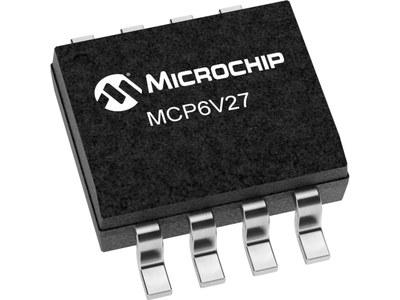{ width="170" } **Option 3 (custom).** Three-op-amp instrumentation amplifier built from 2× Microchip MCP6V27-E/SN zero-drift dual op amps and 0.1 % resistors &#36;3.20/each, &#36;6.40 for two (Mouser) [Microchip MCP6V27-E/SN at Mouser](https://www.mouser.com/en/ProductDetail/Microchip-Technology/MCP6V27-E-SN?qs=36WIQGTfLarwvjZsufRd4A%3D%3D) | \* Built only from op amps, so it satisfies the "op amp stage" rule without special approval \* Zero-drift op amps have about ±2 µV offset, far below the 10 µV per 0.1 kgf signal step \* Rail-to-rail input and output on the 5 V rail \* The fourth op amp is free to buffer the reference voltage | \* CMRR depends on resistor matching: about 7 precision resistors must be matched to 0.1 % \* More parts, more board area and more layout and soldering work \* Two SOIC-8 packages need adapters for breadboard testing |

**Choice:** Option 1: Texas Instruments INA125P (approved by the instructor).

**Rationale:** The load cell signal is only 4 mV at 40 kgf riding on a 2.5 V common-mode voltage, so the first stage must reject common-mode voltage very well while adding almost no offset. The INA125P is a single, proven bridge amplifier: one resistor sets the gain (G = 4 + 60 kΩ / RG, so RG = 100 Ω gives 604), its CMRR is guaranteed, and it comes in a DIP package so I can prove the whole chain on a breadboard before the PCB is milled. Its limited output swing on a 5 V supply is handled by its own internal 1.24 V reference: VREFOUT is set to 1.24 V and drives the IAREF pin directly, so zero force reads 1.24 V and 40 kgf reads about 3.7 V, inside the output swing, with no external op amp. The MCP6N11 is the lowest-cost option, but its offset is higher and its stock is low. Option 3 would need about seven matched precision resistors and three op amps; the instructor approved the INA125P and advised using it as the only amplifier.

### 3. Op Amp for the Active Low-Pass Filter (removed after instructor review)

*Table 3: Low-pass filter op amp selection*

**Low-pass filter op amp — [Individual subsystem: force sensing board]**

| **Solution** | **Pros** | **Cons** |
| --- | --- | --- |
| 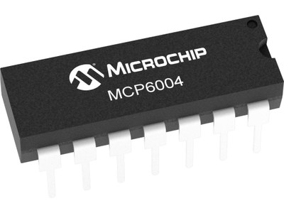{ width="170" } **Option 1.** Microchip MCP6004-I/P quad op amp (DIP-14) &#36;0.60/each (Mouser); issued in class, &#36;0 to my budget [Microchip MCP6004-I/P at Mouser](https://www.mouser.com/en/ProductDetail/Microchip-Technology/MCP6004-I-P?qs=VLwvNDPaIpqIfz2%252Bgie0oA%3D%3D) | \* Already in my class kit, so it costs nothing and is available now \* Four op amps in one package: Sallen-Key filter, REF buffer and a spare for a gain stage \* Rail-to-rail input and output on 1.8 V to 6.0 V, so it drives the ADC across nearly 0–5 V \* 1 MHz gain-bandwidth is far above the 10 Hz cutoff \* DIP package for breadboard prototyping | \* Offset up to ±4.5 mV, although after the INA125P gain this equals only about 6 µV at the input and is removed by taring \* Larger package than a dual op amp \* Lower precision than newer CMOS op amps |
| 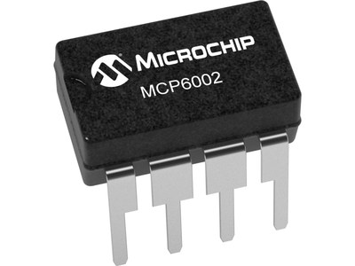{ width="170" } **Option 2.** Microchip MCP6002-I/P dual op amp (DIP-8) &#36;0.45/each (Mouser) [Microchip MCP6002-I/P at Mouser](https://www.mouser.com/en/ProductDetail/Microchip-Technology/MCP6002-I-P?qs=Ux5rHyN1IXStLRM979v6Rg%3D%3D) | \* Same rail-to-rail, 1 MHz family as the MCP6004, so the filter design is identical \* Smaller DIP-8 footprint \* Inexpensive and widely stocked | \* Only two op amps: the filter and REF buffer use both, leaving no spare \* Must be purchased, while the MCP6004 is already in hand |
| 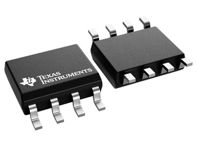{ width="170" } **Option 3.** Texas Instruments TLV9062IDR dual op amp (SOIC-8) &#36;1.05/each (Mouser) [TI TLV9062IDR at Mouser](https://www.mouser.com/en/ProductDetail/Texas-Instruments/TLV9062IDR?qs=u4fy%2FsgLU9PUtszsvUsi6w%3D%3D) | \* Lower offset (±0.3 mV typical) and 10 MHz gain-bandwidth \* Rail-to-rail input and output on 1.8 V to 5.5 V \* SOIC-8 is compact and millable | \* Surface-mount only, so it needs an adapter for breadboard testing \* 5.5 V maximum supply leaves little margin above 5 V \* Extra precision and speed are not needed for a 10 Hz filter after a high-gain stage |

**Choice:** None. The MCP6004-I/P (Option 1) was the original choice, but it is no longer used on the board.

**Rationale:** The comparison above was made for a second-order Sallen-Key filter, a buffer for the INA125P reference and a buffer for the DAC output. After reviewing the schematic, the instructor advised that these op-amp stages make the circuit more complicated than this course needs. The board now uses:

- **No reference buffer:** the INA125P's internal 1.24 V reference drives its IAREF pin directly (Section 2).
- **A passive RC low-pass filter** instead of the Sallen-Key filter: 15 kΩ and 1 µF give a cutoff of 1 / (2π × 15 kΩ × 1 µF) ≈ 10.6 Hz. That is still well above the few hertz of a human grip, and it attenuates 60 Hz mains pickup by about 15 dB; averaging the ADC readings over one mains period in firmware removes the rest. The 1 µF capacitor also acts as a charge reservoir for the ADC's sample capacitor, so the 15 kΩ source resistance does not disturb the conversion.
- **No DAC buffer:** FORCE_ANA goes from DAC1 (RA2) straight to the ribbon cable, because the motor board's ADC input draws no DC current.

Removing the MCP6004 also removes 30 mA from the worst-case power budget and one IC from the PCB.

### 4. 5 V Voltage Regulator

*Table 4: 5 V regulator selection*

**+5 V linear regulator — [Individual subsystem: force sensing board]**

| **Solution** | **Pros** | **Cons** |
| --- | --- | --- |
| 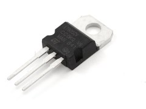{ width="150" } **Option 1.** STMicroelectronics L7805ABV-DG 5 V, 1.5 A linear regulator (TO-220) &#36;1.04/each (Mouser); issued in class, &#36;0 to my budget [ST L7805ABV-DG at Mouser](https://www.mouser.com/en/ProductDetail/STMicroelectronics/L7805ABV-DG?qs=WHlX%252B%252B9%2FRwBQWEBhrAcOaw%3D%3D) | \* 1.5 A output covers the worst-case 497 mA budget for the 5 V rail with large margin \* ±2 % output tolerance (AB grade) and internal current limit and thermal shutdown \* 7 V to 35 V input works with the 9 V adapter \* Through-hole TO-220 is easy to solder and bolts to a heatsink \* Already in my class kit and used by all three team boards | \* About 2 V dropout, so the input must stay above 7 V \* Linear regulator wastes (9 V − 5 V) × I as heat: about 2 W at the worst-case budget, so it needs a heatsink \* Higher quiescent current than a modern LDO |
| 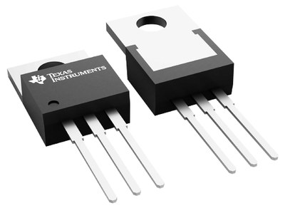{ width="170" } **Option 2.** Texas Instruments LM2940CT-5.0/NOPB 5 V, 1 A low-dropout regulator (TO-220) &#36;2.04/each (Mouser) [TI LM2940CT-5.0/NOPB at Mouser](https://www.mouser.com/en/ProductDetail/Texas-Instruments/LM2940CT-5.0-NOPB?qs=X1J7HmVL2ZHd4yipOGCVKg%3D%3D) | \* Low dropout (0.5 V typical at 1 A), so it keeps working if the input sags toward 6 V \* 1 A output still covers the worst-case budget \* Reverse-battery and mirror-insertion protection \* Same TO-220 footprint as Option 1 | \* Out of stock at Mouser, with stock expected January 2027 (20-week lead time) \* Needs a larger output capacitor with a controlled ESR to stay stable \* Costs more and is not in the class kit |
| 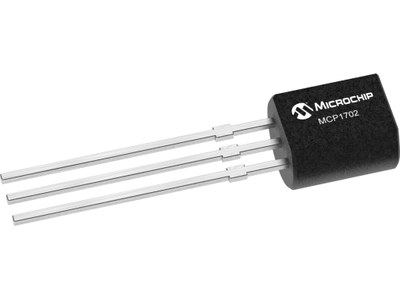{ width="170" } **Option 3.** Microchip MCP1702-5002E/TO 5 V, 250 mA low-dropout regulator (TO-92) &#36;0.65/each (Mouser) [Microchip MCP1702-5002E/TO at Mouser](https://www.mouser.com/en/ProductDetail/Microchip-Technology/MCP1702-5002E-TO?qs=jZi1jxfVU96jFzuz5k6DAw%3D%3D) | \* Very low quiescent current (about 2 µA), useful for battery designs \* Small through-hole TO-92 package \* Needs only two small ceramic capacitors | \* 250 mA maximum output is below the worst-case 497 mA budget for the 5 V rail \* 13.2 V maximum input leaves little margin for adapter overshoot \* TO-92 can only dissipate a fraction of a watt, so a 4 V drop limits it to about 100 mA in practice |

**Choice:** Option 1: STMicroelectronics L7805ABV-DG.

**Rationale:** The [power budget](../05-Power-Budget/Power-Budget.md) puts the worst-case 5 V rail current at 497 mA including the 25 % safety margin, which rules out the 250 mA MCP1702. Both TO-220 regulators can supply it, but the L7805ABV-DG is already in my kit, is the regulator the whole team uses (shared footprint and spares), and is in stock, while the LM2940 is back-ordered until 2027. Its 2 V dropout is not a problem because the 9 V adapter leaves 2 V of headroom above the 7 V minimum input. At the worst-case budget it would dissipate about 2 W, so I will mount it on a Boyd 507302B00000G TO-220 heatsink (&#36;0.34); at the expected normal draw of under 100 mA it dissipates less than 0.4 W.

### 5. External Power Source (9 V Wall Adapter)

*Table 5: External power source selection*

**9 V wall adapter — [Individual subsystem: force sensing board]**

| **Solution** | **Pros** | **Cons** |
| --- | --- | --- |
| 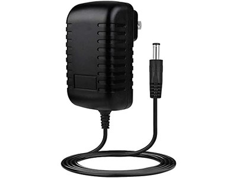{ width="150" } **Option 1.** BestCH 9 V 3 A switching wall adapter (issued in class) &#36;4.52/each (Amazon B09ZTKTLGW); &#36;0 to my budget [BestCH 9 V 3 A adapter on Amazon](https://www.amazon.com/dp/B09ZTKTLGW) | \* 3 A output covers the regulator's full 1.5 A rating with 1.5 A to spare \* Already issued in class, so it costs nothing and is available now \* 9 V gives the L7805 its required 2 V of headroom without excessive heat \* 100–240 VAC input and a 5.5 mm barrel plug | \* No manufacturer datasheet, only the specifications in the store listing \* Plug inner diameter and polarity are not stated, so the fit to the PJ-102AH jack and center-positive polarity must be checked with a multimeter before first power-up \* Amazon parts are not reimbursable, so a replacement would come out of pocket |
| 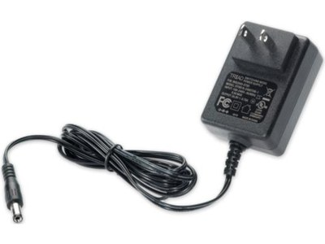{ width="170" } **Option 2.** Triad Magnetics WSU090-2000 9 V 2 A wall adapter &#36;12.43/each (Mouser) [Triad WSU090-2000 at Mouser](https://www.mouser.com/en/ProductDetail/Triad-Magnetics/WSU090-2000?qs=B4sXYbYweUqXGsCe5mLH3w%3D%3D) | \* Full [datasheet](https://catalog.triadmagnetics.com/Asset/WSU090-2000.pdf): ±5 % regulation, 150 mV ripple maximum, short-circuit and over-voltage protection \* UL 62368-1 listed and DoE Level VI efficient \* 2.1 × 5.5 mm center-positive plug matches standard barrel jacks \* 2 A covers the regulator's 1.5 A rating | \* Costs &#36;12.43 of my budget plus shipping \* Only 500 mA of spare capacity above the regulator rating \* Must be ordered and waited for |
| 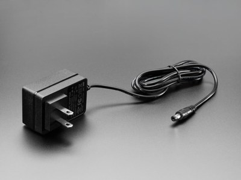{ width="170" } **Option 3.** Adafruit 63 9 V 1 A regulated switching wall adapter &#36;8.95/each (Adafruit) [Adafruit 63 product page](https://www.adafruit.com/product/63) | \* UL listed, with a datasheet linked on the product page \* 2.1 × 5.5 mm center-positive plug \* Small and light; 100–240 VAC input | \* 1 A is less than the regulator's 1.5 A rating, so the power budget's source check fails (−500 mA) \* Adds another vendor, order and shipping charge \* Costs more than the class-issued adapter |

**Choice:** Option 1: BestCH 9 V 3 A wall adapter (class-issued), with Option 2 as the documented backup.

**Rationale:** The power budget requires the source to supply the full rating of every regulator connected to it. The BestCH adapter supplies 3 A against the L7805's 1.5 A, so 1.5 A remains, and it is already in hand at no cost. A 9 V supply is the best voltage for this board: it gives the L7805 its 2 V of dropout headroom while keeping the regulator's heat lower than a 12 V adapter would. Because the adapter has no manufacturer datasheet, I will measure its polarity and no-load voltage and check the plug fit on the PJ-102AH jack before connecting the board. If it fails those checks, the Triad WSU090-2000 is the replacement: it has a full datasheet and safety listing and still passes the power budget at 2 A. The Adafruit adapter was rejected because its 1 A rating fails the source check.

## Summary of Selected Components

*Table 6: Final selections for the force sensing board*

| Block | Selected part | Unit cost | Qty | Source |
| --- | --- | --- | --- | --- |
| Load cell | Phidgets 3135_0 | &#36;7.00 | 2 (1 spare) | Phidgets |
| Instrumentation amplifier | TI INA125P | &#36;12.78 | 2 (1 spare) | Digi-Key / Mouser |
| Low-pass filter | Passive RC: 15 kΩ 1 % resistor, 1 µF X7R capacitor | under &#36;1 | 1 set | Digi-Key / lab stock |
| 5 V regulator | ST L7805ABV-DG (+ Boyd 507302B00000G heatsink, &#36;0.34) | &#36;0 | 1 | Class kit |
| 9 V power source | BestCH 9 V 3 A adapter | &#36;0 | 1 | Issued in class |

The major components above cost &#36;39.56 of my &#36;60 budget; connectors, sockets and the heatsink bring the planned order to about &#36;50 before shipping.

## Microcontroller Pin Table

*Table 7: PIC18F57Q43 Curiosity Nano pin assignments on the force sensing board*

| Function | Module | Type | Pin | Direction | Connects to |
| --- | --- | --- | --- | --- | --- |
| Filtered force voltage | ADC (ADCC) | Analog in | RA0 | In | RC low-pass filter output (R5, C8) |
| FORCE_ANA (analog copy of force) | DAC1 | Analog out | RA2 | Out | J2 pin 6 → motor board (unbuffered) |
| UART F→M | UART3 TX | Digital | RA3 | Out | J2 pin 1 → motor board |
| UART M→F | UART3 RX | Digital | RA4 | In | J2 pin 2 ← motor board |
| UART F→U | UART1 TX | Digital | RC2 | Out | J1 pin 1 → UI board |
| UART U→F | UART1 RX | Digital | RC3 | In | J1 pin 2 ← UI board |
| UI_RUN | GPIO | Digital in | RD0 | In | J1 pin 3 ← UI board |
| FORCE_OK (safety line) | GPIO | Digital out | RD1 | Out | J2 pin 3 → motor board |
| Debug LED (on PCB, planned) | GPIO | Digital out | RD2 | Out | LED + 1 kΩ resistor to GND |
| Debug button (on PCB, planned) | GPIO | Digital in (weak pull-up) | RD3 | In | Pushbutton to GND |
| On-board LED0 | GPIO | Digital out | RF3 | Out | Curiosity Nano LED (built in) |
| On-board SW0 | GPIO | Digital in | RB4 | In | Curiosity Nano button (built in) |
| Programming / debug | ICSP | — | RB6, RB7, MCLR | — | Reserved for the on-board debugger |
| USB serial (CDC) | UART | — | RF0, RF1 | — | Reserved for the debugger's virtual COM port |
| Target power | VTG | Power | VTG | In | +5 V rail from the L7805ABV-DG |
| Regulator disable | VOFF | Power | VOFF | In | Tied to GND so the board can be powered through VTG |
| Ground | GND | Power | GND | — | Board ground, ribbon pin 8 on J1 and J2 |

The ribbon connector pinouts (J1 to the UI board, J2 to the motor board) are listed in Tables 2 and 3 of the [block diagram page](../01-Block-Diagram/Block-Diagram.md). The debug LED and button pins are new since the block diagram and will be confirmed in the schematic.

## Use of Generative AI

Generative AI (Claude) was used to research and compare candidate parts, collect prices, photos and datasheet values, draft the selection tables, pros, cons and rationale on this page, and fill in the power budget template. I reviewed the part choices, prices and pin assignments and edited the text before submission.

Query text (translated from Chinese):

1. How do we decide our parts? Is it best for the group to use the same manufacturer? Each of us has a &#36;60 budget. Do a detailed investigation to help us select parts.
2. Use all the parts you recommended. We can spend more as long as it stays under budget; prioritize making sure it works and not adding complexity.
3. What do I need to submit?
4. Here is the power budget, check to make sure every requirement of the assignment is covered.
