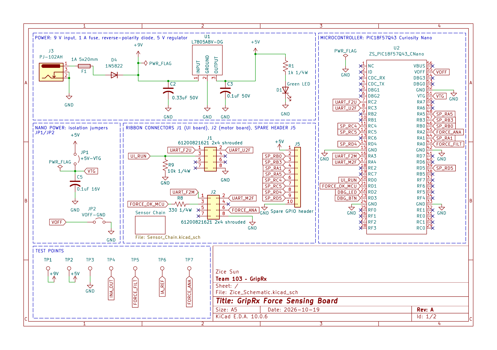
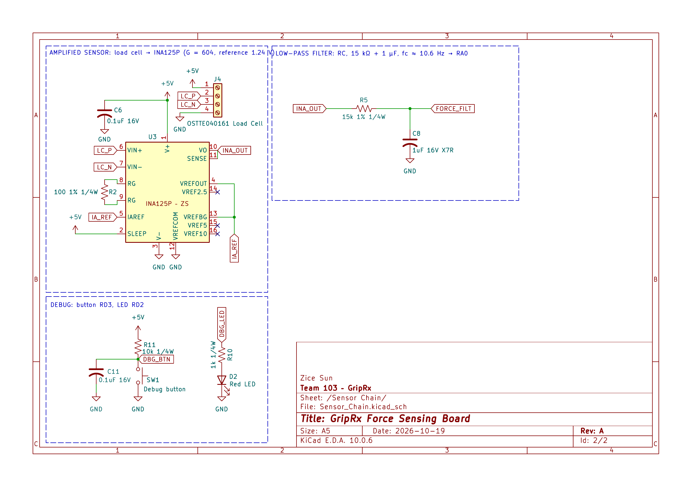

## Overview

This schematic shows the GripRx force sensing board. Sheet 1 contains the 9 V input with a 1 A fast-acting fuse, a 1N5822 reverse-polarity diode and the L7805 5 V regulator, the PIC18F57Q43 Curiosity Nano with isolation jumpers, the ribbon connectors to the UI board (J1) and motor board (J2), a spare GPIO header and test points. Sheet 2 contains the load cell signal chain: an INA125P instrumentation amplifier with a gain of 604 (R2 = 100 Ω) that uses its own internal 1.24 V reference, a passive RC low-pass filter (R5 = 15 kΩ, C8 = 1 µF, cutoff about 10.6 Hz) into ADC pin RA0, and the debug button and LED. The analog copy of the force for the motor board (FORCE_ANA) comes straight from DAC1 on RA2.

**Revision (10/26):** following instructor feedback, the MCP6004 op amp was removed. The INA125P reference buffer and the DAC output buffer are gone, and the second-order Sallen-Key filter was replaced by the single RC filter above. This keeps one amplifier IC in the signal chain.

**Note:** GitHub is currently having issues displaying images. If the schematic images below do not display, please download the [schematic PDF](Zice_Schematic.pdf). The schematic PDF is also submitted directly to Canvas.

**Figure 1.** Sheet 1: power, microcontroller, connectors and test points.

**Figure 2.** Sheet 2: load cell signal chain and debug.

## How the Circuit Meets the User Needs

**Accurate force for the therapist's prescription (SW-06, MF-03).** The load cell gives about 0.1 mV per kgf at 5 V excitation. The INA125P amplifies the bridge difference by G = 4 + 60 kΩ / R2 = 604 and rejects the 2.5 V common-mode voltage. Its reference pins are wired so that VREFOUT is the internal 1.24 V bandgap (VREFOUT tied to VREFBG), and that voltage drives the IAREF pin. Zero force therefore reads 1.24 V instead of sitting at the bottom rail, and 40 kgf reads about 1.24 V + 604 × 4 mV ≈ 3.7 V, inside the amplifier's output swing on a 5 V supply. With the 12-bit ADC, 0.1 kgf is about 5 counts, which meets the 0.1 kgf resolution goal. Calibration uses known weights; test point TP4 (INA_OUT), TP5 (FORCE_FILT) and TP6 (IA_REF) let each stage be measured.

**A steady reading at the speed of a grip (UX-02).** A grip changes at only a few hertz. The RC filter (cutoff about 10.6 Hz) passes that, reduces 60 Hz mains pickup by about 15 dB, and its 1 µF capacitor holds the ADC input steady while the converter samples. Averaging in firmware over one mains period removes the rest, and the reading still updates far faster than the 5 Hz display requirement.

**Safety when the force is too high or a cable comes loose (SF-01).** The force board drives FORCE_OK (RD1, through R8) to the motor board, which has a pull-down on that line, so the motor releases if the force board says so or if the cable is unplugged. UI_RUN from the UI board has a 10 kΩ pull-down (R9) here, so an unplugged UI cable reads as "stop".

**Safe, simple power (MF-01).** A 1 A fast-acting fuse limits a short, the 1N5822 blocks a reversed adapter, and the L7805 with its datasheet capacitors makes the single 5 V rail. Jumpers JP1 and JP2 separate the board supply from the Curiosity Nano's USB power, so the board can also be tested from USB alone.

## Resources

- [Schematic (PDF)](Zice_Schematic.pdf)
- [KiCad project (ZIP)](Zice_Schematic.zip)

## Use of Generative AI

I used Claude (Anthropic) for this assignment. Claude produced a reference schematic drawing and parts list, fixed the U4A input polarity, a label typo and six missing connections. I did the rest of the wiring, the layout and the section labels myself. Full queries:

1. "I am doing EGR 304 individual assignment schematics, give me the full overview and what to do [assignment link]."

2. "What parts do I need to draw? How do I draw them?"

3. "Should I use Earth or GND?"

4. "Generate a sample look of the schematics."

6. "How to draw dashed blocks?"

7. "Check my previous projects: are there any other circuits/parts I can reuse?"

8. "About the PIC Design (and other circuits) you said I could copy and reuse, which part exactly and how do I reuse?"

9. "What do I need to submit?"

10. "ERC is good, check my schematics before turning in."

11. "How do I export PNG?"

12. "What do I do again when images don't display? [schematic page link]"

13. "My instructor said: use a normal fuse, not slow-blow; the INA125P is an op amp, so use only one; an RC filter is enough for the low-pass filter; and the DAC buffer and reference buffer are not needed. Is he right? Should I take all of it?"

14. "Following the instructor's advice, I deleted the reference buffer and the buffer from my schematic and changed the low-pass filter to a simple RC filter. Check for whatever is missing in the drawing."