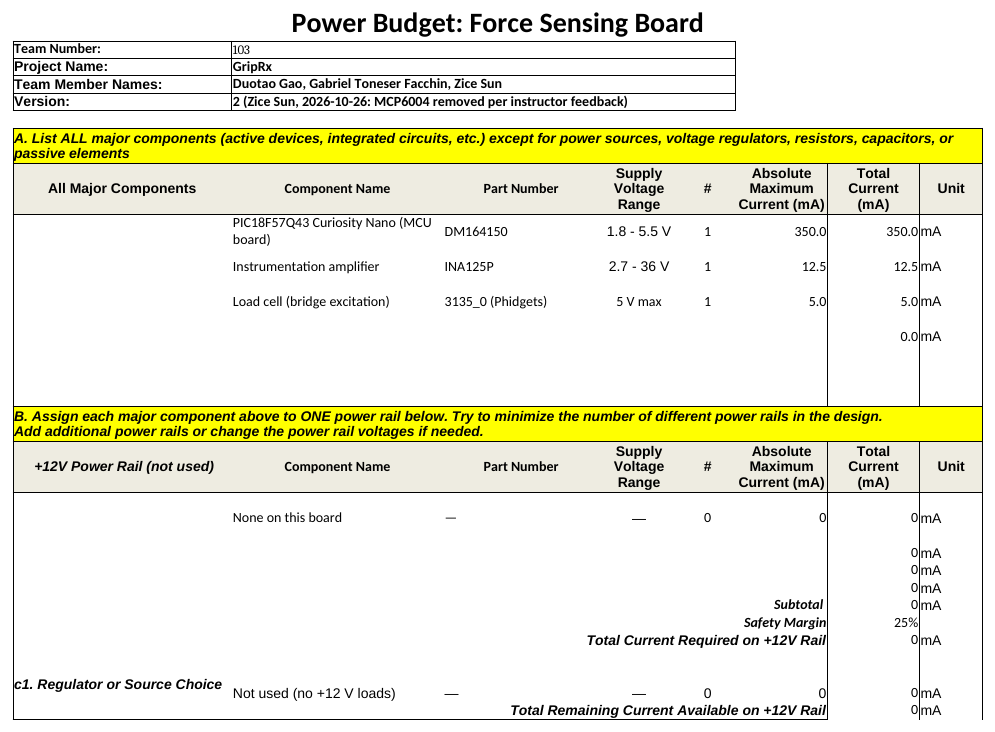
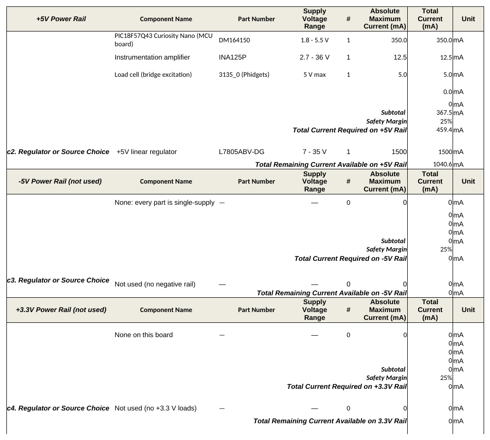
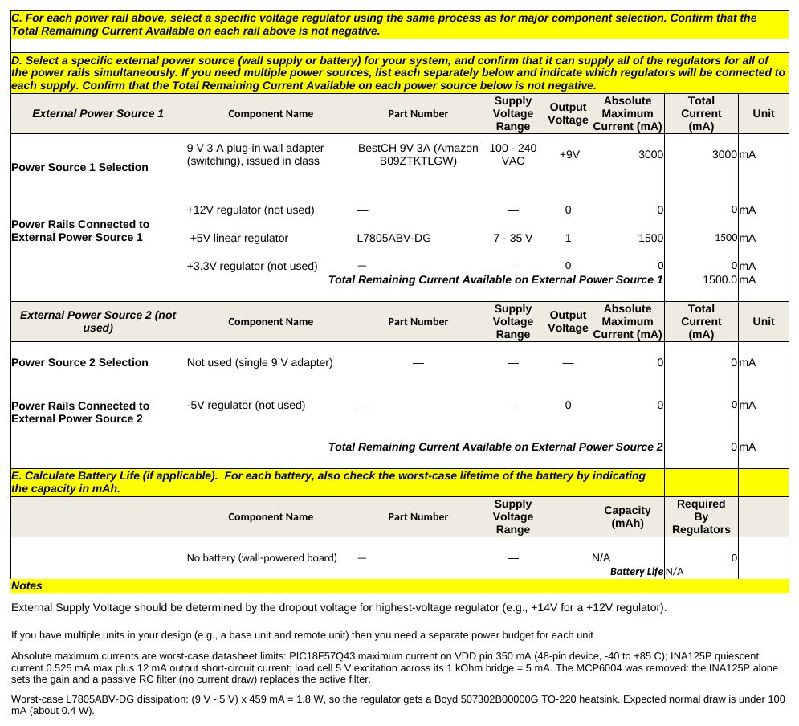

# Power Budget: Force Sensing Board

**Zice Sun** · Team 103 · Project: **GripRx**

## Overview

The power budget checks that the voltage regulator and the external power source I selected on the [Component Selection](../02-Component-Selection/Component-Selection.md) page can power every part of the force sensing board at the same time, even in the worst case. It uses the class template and lists each major component's **absolute maximum** current from its datasheet, so the result is a safe upper bound rather than a typical value. The force sensing board has its own wall adapter and regulator, so it gets its own power budget, separate from my teammates' boards.

The design follows the walkthrough's advice to keep the number of power rails as small as possible: every part on this board runs from a **single +5 V rail**. The instrumentation amplifier is a single-supply part, so no negative rail is needed, and nothing needs +12 V or +3.3 V. The unused rails in the template are marked "not used".

## Power Budget

*Figure 1: Power budget for the force sensing board, filled in on the class template.*

## How Each Section Was Filled In

**A. Major components.** Three components draw power from the board; the regulator and power source are not listed here, as the template instructs. Each current is the absolute maximum from the datasheet:

| Component | Part number | Supply range | Absolute maximum current | Datasheet basis |
| --- | --- | --- | --- | --- |
| PIC18F57Q43 Curiosity Nano | DM164150 | 1.8 – 5.5 V | 350 mA | Maximum current on the VDD pin, 40/44/48-pin devices, −40 °C to +85 °C |
| Instrumentation amplifier | INA125P | 2.7 – 36 V | 12.5 mA | 0.525 mA maximum quiescent current plus 12 mA output short-circuit current |
| Load cell excitation | Phidgets 3135_0 | 5 V maximum | 5 mA | 5 V across the 1 kΩ bridge |

**B. Power rails.** All three components are on the +5 V rail. Their total is 367.5 mA; with the 25 % safety margin (which also covers the passive parts, the debug LED and other small loads) the rail must supply **459.4 mA**.

This is version 2 of the budget. Following instructor feedback, the MCP6004 quad op amp (30 mA) was removed from the design: the INA125P alone now sets the gain, and a passive RC low-pass filter, which draws no supply current, replaces the active filter. Removing it lowered the worst-case requirement from 496.9 mA to 459.4 mA.

**C. Regulator.** The STMicroelectronics L7805ABV-DG can supply 1500 mA, leaving **1040.6 mA** of spare current on the +5 V rail. At the worst-case load it would dissipate (9 V − 5 V) × 0.459 A ≈ 1.8 W, so it gets a Boyd 507302B00000G TO-220 heatsink; the expected normal draw is under 100 mA (about 0.4 W). The regulator comparison (L7805ABV-DG, LM2940CT-5.0, MCP1702) is in Table 4 of the Component Selection page.

**D. External power source.** The class-issued BestCH 9 V 3 A wall adapter feeds the only regulator. Counting the regulator at its full 1500 mA rating, **1500 mA** remains, so the adapter can supply the board in every case. A 9 V input gives the L7805ABV-DG its required 2 V of dropout headroom (7 V minimum input). The adapter comparison is in Table 5 of the Component Selection page.

**E. Battery life.** Not applicable: the board is powered from the wall and has no battery.

## Conclusions

The force sensing board needs only one regulated +5 V rail. In the worst case it needs 459.4 mA including the 25 % safety margin; the L7805ABV-DG regulator (1500 mA) and the 9 V 3 A adapter (3000 mA) both have positive remaining current, so the selected regulator and power source are sufficient. The main design consequence is heat: the regulator must have a heatsink so that it stays safe even at the worst-case current.

## Resources

The power budget is available as a [PDF](PowerBudget_ZiceSun.pdf) and as a [Microsoft Excel workbook](PowerBudget_ZiceSun.xlsx).
