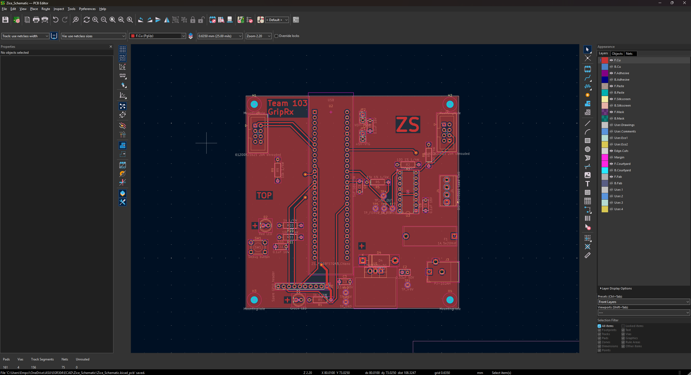
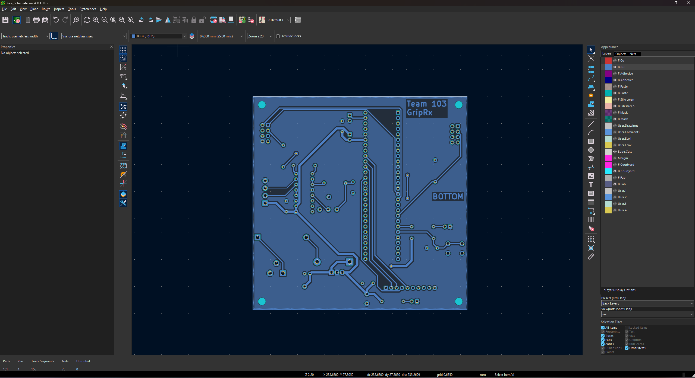

# PCB Design: Force Sensing Board

**Zice Sun** · Team 103 · Project: **GripRx**

## Overview

This page shows the printed circuit board (PCB) layout of the force sensing board, made in KiCad 10 from the updated [schematic](../04-Schematic/schematic.md). The board is 100 mm × 100 mm with two copper layers and no solder mask or silkscreen, so it can be milled at Peralta. It follows the Peralta PCB mill specifications for 0.5 oz copper: signal traces are 20 mil, power traces are 40 mil, and a few short segments are 15 mil, the course minimum. Both layers carry a ground pour, and the whole board uses only 4 vias. My initials (**ZS**) are in large bold text on the top copper, and each side is labeled TOP or BOTTOM with the team name.

All custom footprints (Curiosity Nano, ribbon connectors, fuse holder, regulator with heatsink, headers and push button) carry my initials and are in my own footprint library, `ZS_Footprints`, which is included in the KiCad project archive below.

**Note:** if the images below do not display, please download the [PCB layout PDF](Zice_PCB_Front_Back.pdf).

## PCB Layout

**Figure 1.** Top layer (F.Cu) with the ground pour, footprints and the ZS initials.

**Figure 2.** Bottom layer (B.Cu) with the ground pour and the BOTTOM and team-name labels.

## Layout Decisions

**Placement by function.** The PIC18F57Q43 Curiosity Nano sits in the middle of the board, so traces to every section stay short. The two ribbon connectors are in the top corners: J1 (UI board) on the left and J2 (motor board) on the right, so both cables leave from the same edge toward my teammates' boards. The load cell signal chain is on the right side: the load cell terminal block J4 is on the board edge, next to the INA125P (U3, in a socket), its gain resistor and the RC low-pass filter, with test points TP4 to TP7 between the stages. The debug LED and debug button are on the left side, and the spare GPIO header J5 is along the bottom.

**Power section.** The 9 V barrel jack J3, the 1 A fuse F1, the 1N5822 reverse-polarity diode D4 and the L7805 regulator U1 are grouped in the bottom-right corner, in the order the current flows. The regulator footprint includes the outline of the TO-220 heatsink, so nothing else is placed under it. The fuse holder footprint was drawn for the 5 × 20 mm holder (22.75 mm pin spacing) from the actual part's dimensions.

**Routing.** Traces are split between the two layers, with only 4 vias, and the ground pour fills the rest of both sides so every ground pin connects without extra traces. Power (+9 V and +5 V) uses the 40 mil Power net class; all other nets use 20 mil. Four M3 mounting holes sit in the corners.

## Design Checks

- **Design rules check (DRC):** 0 violations, 0 unconnected items and 0 schematic parity errors with the course rules (see the [DRC screenshot](Zice_DRC_Confirmation.png)).
- **Board size:** 100.0 mm × 100.0 mm, within the 100 mm × 100 mm limit.
- **Manufacturing pre-check:** the Gerber files were checked with the JLCDFM online DFM tool. The copper and drill checks reported no danger items; the silkscreen and solder mask warnings do not apply because the milled board has neither (see the [DFM report](Zice_JLCDFM_Report.pdf)).

## Resources

- [PCB layout, top and bottom (PDF)](Zice_PCB_Front_Back.pdf)
- [KiCad project archive, including the footprint and symbol libraries (ZIP)](Zice_PCB_Project.zip)
- [Gerber and drill files (ZIP)](ZiceSun103.zip)
- [DRC screenshot (PNG)](Zice_DRC_Confirmation.png)
- [JLCDFM analysis report (PDF)](Zice_JLCDFM_Report.pdf)

## Use of Generative AI

I used Claude (Anthropic) for this assignment. Claude provide suggestions on DRC errors and footprints, reviewed the JLCDFM report, converted my images and PDFs, and drafted this page. I did the placement and routing in KiCad myself and checked every change with DRC. Queries:

1. "How do I fix these DRC errors?" (screenshots of thermal relief and silkscreen errors)

2. "Can F.Cu text touch a trace?" and "Can it overlap the courtyard?"

3. "What is the K or + mark for? Does it go at the square pad? Where is the IDC header key?"

4. "The fuse seems to be 5x20." and "The fuse holder pins are 22.75 mm apart, the holder is 24.5 mm long and 8.9 mm wide. Give me the x and y positions."

5. "How do I find where a part is in the PCB?"

6. "Is the report OK?" (JLCDFM report)

7. "Set up the PCB Design page skeleton file, following my other pages."
